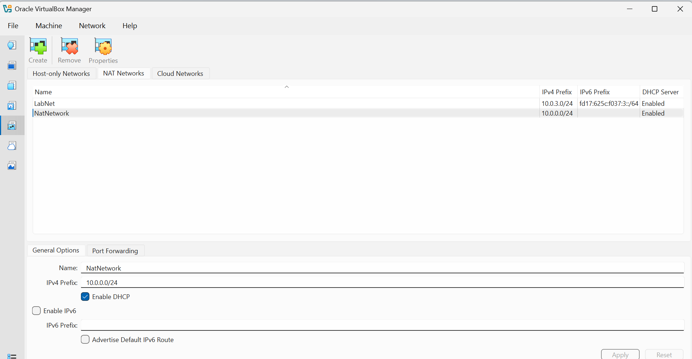
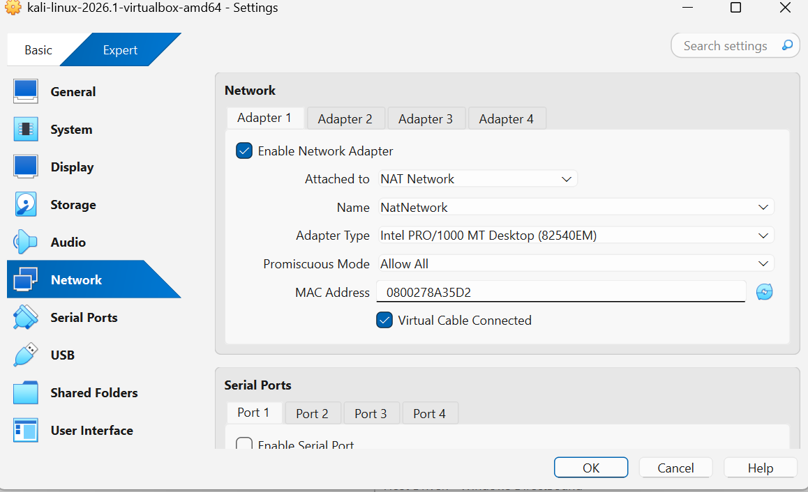
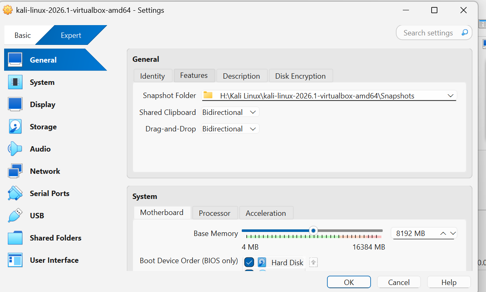
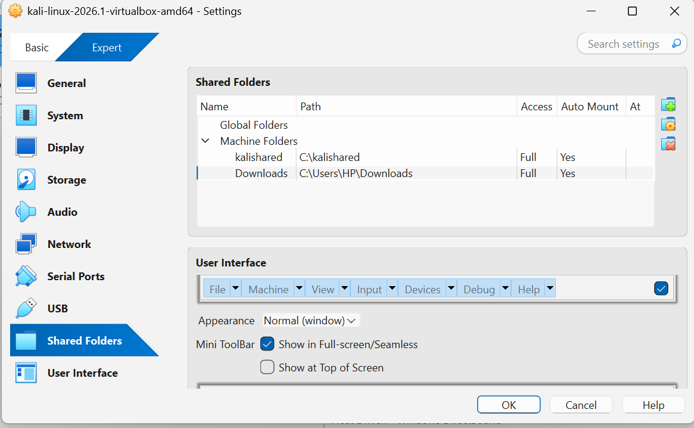
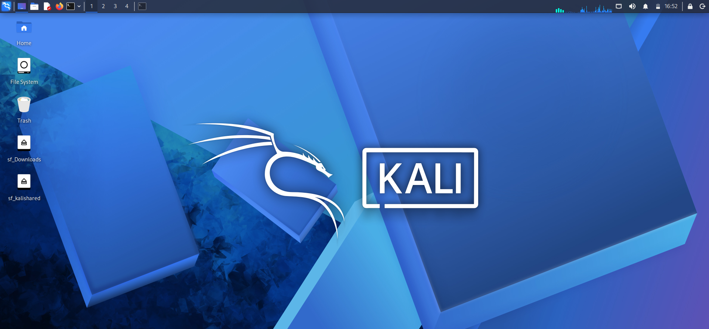
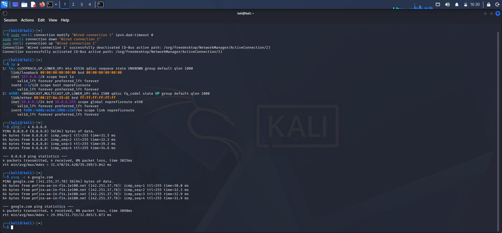
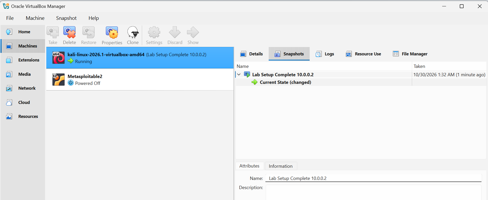

# Cybersecurity Lab Environment Setup

Building an isolated virtual lab for penetration testing and ethical hacking practice.

**Intern:** Muhammad Hasnain | **Batch:** B084 | **Program:** Networkwalks Cybersecurity Internship | **Week 1, Project Module 1**

---

## Project Overview

This project sets up a virtual cybersecurity and penetration-testing laboratory using VirtualBox and Kali Linux.

The lab runs on a private virtual network (NAT Network, subnet 10.0.0.0/24) so that more machines can be added later and used as targets for authorized security testing. All testing is done only inside my own lab environment.

## Lab Details

| Item | Value |
|------|-------|
| Host OS | Windows |
| Virtualization | Oracle VirtualBox |
| Attacker machine | Kali Linux 2026.1 |
| Network type | NAT Network (`NatNetwork`) |
| Subnet | 10.0.0.0/24 |
| Kali IP address | 10.0.0.2/24 |
| Gateway | 10.0.0.1 |
| DNS | 8.8.8.8 |

## Steps Performed

### 1. Created the NAT Network
In VirtualBox: File > Tools > Network > NAT Networks. Created `NatNetwork` with IPv4 prefix `10.0.0.0/24` and DHCP enabled.



### 2. Configured the Kali VM network adapter
Kali VM Settings > Network > Adapter 1: Attached to **NAT Network**, Name **NatNetwork**, Promiscuous Mode **Allow All**.



### 3. Enabled Shared Clipboard and Drag-and-Drop
Kali VM Settings > General > Features: both set to **Bidirectional**.



### 4. Added the Downloads shared folder
Kali VM Settings > Shared Folders: added the host Downloads folder with Full access and Auto-mount enabled.



### 5. Verified the shared folder inside Kali
After starting Kali, the shared folder appears on the desktop as `sf_Downloads`.



### 6. Set the static IP and tested internet
Used `nmtui` > Edit a connection > Wired connection 1 > IPv4 Manual, with address `10.0.0.2/24`, gateway `10.0.0.1` and DNS `8.8.8.8`. Then applied the connectivity fix and restarted the connection:

```
sudo nmcli connection modify "Wired connection 1" ipv4.dad-timeout 0
sudo nmcli connection down "Wired connection 1"
sudo nmcli connection up "Wired connection 1"
```

Verified with `ip a`, `ping -c 4 8.8.8.8` and `ping -c 4 google.com`. Result: IP is 10.0.0.2/24 and there is 0% packet loss, so Kali has full internet access.



### 7. Took a VM snapshot
Took the snapshot `Lab Setup Complete 10.0.0.2` so I can restore the clean working state at any time.



---

## Troubleshooting

**Problem:** When setting the IPv4 method to Manual in `nmtui`, it showed: *"Unable to save connection: method 'manual' requires at least an address or a route."*

**Solution:** I had changed the method to Manual but had not added an address. After adding the address `10.0.0.2/24`, the gateway and the DNS, the connection saved correctly.

**Tip:** On VirtualBox 7 with Kali 2026.1 or newer, internet can fail after setting a static IP. Running the three `nmcli` commands above fixed it.

## Learning Outcomes

- Built an isolated virtual lab using VirtualBox
- Configured a custom NAT Network and a static IP on Kali Linux
- Used `nmtui` and `nmcli` to manage network connections
- Set up shared folders, clipboard and drag-and-drop
- Used snapshots to save a clean lab state

## Disclaimer

This lab is for education only. Everything was done on my own virtual lab environment. Never test systems without written permission.

---
*Networkwalks Cybersecurity Internship | Batch B084*
